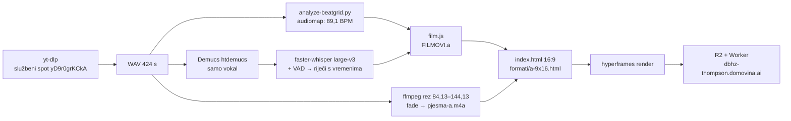

# Video „Kralj Tomislav" — kako je nastao isječak A (2026-10-19)

Kod je u `domovinatv/hyperframes-domovina-ai` → `videos/dbhz-kralj-tomislav/`
(stanje i sljedeći koraci u njegovom `NEXT.md`). Ovdje je ono što se ne vidi iz
koda: mjerenja, odbačeni putevi i zamke.

## Tekst pjesme s vremenima — tri pokušaja

| Pokušaj | Rezultat |
|---|---|
| `hyperframes transcribe` (whisper.cpp large-v3) na cijelom miksu | 62 riječi, sve halucinacija: „Pogledajte naš kanal" svakih 30 s |
| isto, na Demucs vokalu | 283 riječi, dijelom točno („blagoslov od pape" ~304 s), ostalo „Hvala što pratite kanal" u petlji |
| **faster-whisper large-v3, VAD, `condition_on_previous_text=False`, na vokalu** | upotrebljivo: svi stihovi s vremenima; neke riječi krivo („Dubanjskom", „Žezdo"), vremena dobra |

Riječi u `film.js` su ručno ispravljene, a vremena su iz transkripta.

## Zamke

- **numba ne radi s NumPy 2.5** (sistemski Python 3.13) → `analyze-beatgrid.py`
  pada. Rješenje: venv s `numpy<2.5`.
- **faster-whisper + PyAV u venvu**: `av.open()` ne prima `metadata_errors` →
  audio učitati librosom (16 kHz mono) i predati numpy niz.
- **Ne premještaj ulaznu datoteku dok transkripcija radi u pozadini** — whisper
  model se prvo 3 GB skida, pa ffmpeg čita datoteku tek minutama kasnije.
- **HyperFrames lint ne vidi `window.__timelines[...]` u vanjskom `.js`** → registracija
  mora biti inline (`import { buildFilm } from "./main.js"` u `<script type="module">`).
- **Bare import `"main.js"` ne radi** u modulu — mora `./main.js`; bez toga se ništa
  ne izvrši, a snapshot pokaže sve natpise odjednom i nijednu bistu.
- **Dvije root kompozicije u istom folderu** = lint greška (dupli audio). Vertikalna
  ide u `formati/`, render s `-c formati/a-9x16.html`.
- **`hyperframes snapshot` nema `-c`** → za 9:16 privremena kopija projekta gdje je
  vertikalna datoteka `index.html`.
- **CSS `transform` + GSAP `y` na istom elementu** → `gsap_css_transform_conflict`;
  centriranje preko flexa / `top`.

## Odluke

- **Jedna kontinuirana Three.js scena, ne music-to-video frame-worker predlošci**:
  bista mora biti isti 3D objekt kroz cijeli film, a predlošci rade rez po kadru.
- **Sve kao funkcija vremena**: rotacija = integral po dijelovima linearne brzine
  (trapezi), materijal = zatvorena forma spec lerpa `k = 1 − e^(−4,5·dt)` od svake
  promjene. Isti piksel za isti t, bez akumulacije po kadrovima.
- **Lice prema kameri na „Žezlo"** (`rotation.frontAt`) umjesto ručnog početnog kuta.
- **9:16**: FitCamera je tamo ograničena širinom pa je bista mala → `zoom 0,8`,
  `shiftY −0,025`; približavanje na refrenu 0,95 (s 0,9 prsten i podnožje izlaze iz kadra u 16:9).

## Isječak B (2026-10-19)

- **Rub reza mjeriti na Demucs vokalu, ne na transkriptu.** Plan 108,3 s bio je
  početak riječi „svoj" (vokal −16 dB od 108,4 do 109,8, zatim < −45 dB). Rez je
  pomaknut na beat 110,04 → 34,09 s, do „Žezlo" (111,91) ostaje ~1,9 s.
- Zato je uvod ubrzan (`intro.tempo 0,5`), a kamera na početku gleda više
  (`lookY 0,2 → 0` do „Žezlo"): u 9:16 je kruna inače ulazila u podnaslov.
- Whisper između „Žezlo i kruna" (113,4) i „od Jadranskog mora" (126,2) nema
  riječi, ali vokal traje 117,5–126 — prvi red refrena zato ostaje do 125,8.
- Render: ~22 s po formatu, 16,5 MB (16:9) i 17,2 MB (9:16); produkcija 206 ✓.

## Isječak C (2026-10-19)

- 297,1–345,07 (48 s): kraj 335,6 iz plana presjekao bi strofu; ona završava ~344,2.
- Whisper završni dio nije čuo ni s promptom (prompt ga je naveo da ponavlja
  prompt). Tekst je dao korisnik; vremena riječi su iz transkripta bez VAD-a.
- Tekst pjesme ne preuzimati s lyrics stranica — samo od korisnika.
- Pauza u vokalu 311–322,8 nosi naslov i odjavu; na kraju se pjeva do zadnje sekunde.

## Mjerenja

- Render 60 s, 1080p, M4 Pro s hardverskim WebGL-om: ~1 min po formatu; 24,1 MB (16:9), 23,0 MB (9:16).
- Produkcija: `/` 200, `bytes=0-99` → 206, cijeli video 200 (24 135 984 B).

## Otvoreno

- Puštanje na pravom iPhoneu nije isprobano (provjeren samo 206).
- Refren u A i B je nepotpun (v. NEXT.md u video repou) — popraviti na zahtjev.
- Prava na glazbu nisu riješena (namjerno izvan opsega; stranica `noindex`).

Vezani dokumenti: [README](../README.md).
